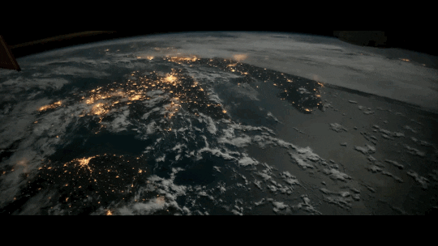

<!-- Banner -->

  

<h1 align="center">Hey, I'm Sierra 👋</h1>

<!-- Typing animation -->

  

<!-- Badges -->

  
  

 

## 🛰️ About me

I like building stuff that actually does something out in the real world. Most of my time goes into computer vision, satellite data, maps and robots. I've done three internships at Lockheed Martin Space working on software for missile warning satellites, mostly DevOps and AI. On my own time I pick some random real problem and build until it works, like counting endangered fish or spraying the pigeons off my roof.

 

## 🚀 Featured projects

<table>
  <tr>
    <td width="50%" valign="top">
      
      <h3><a href="https://github.com/sryanprograms/pigeon_patrol">Pigeon Patrol</a></h3>
      
A pan/tilt water turret on my roof. A camera spots pigeons, the model makes sure it's actually a pigeon, and then it sprays.

      
      
      
    </td>
    <td width="50%" valign="top">
      
      <h3><a href="https://github.com/SVVSDICAI/fishNET-documentation">FishNet</a> 🏆</h3>
      
An underwater camera and CV model that tracked and counted endangered fish for Boulder County Parks & Open Space. It won the World AI Competition for Youth.

      
      
      
    </td>
  </tr>
</table>

 

## 🛠️ What I work with

  

 

## 📍 A few things about me

- 🛡️ Three internships at Lockheed Martin Space (I was also Scrum Master one summer)
- ☁️ AWS Certified Cloud Practitioner
- 🎓 Barrett Honors College and Dean's List every semester
- 🥍 Starting D1 lacrosse player and team captain at ASU
- 💼 Started an AI agent company at 16 with clients in Asia, Australia and Europe

 

  

